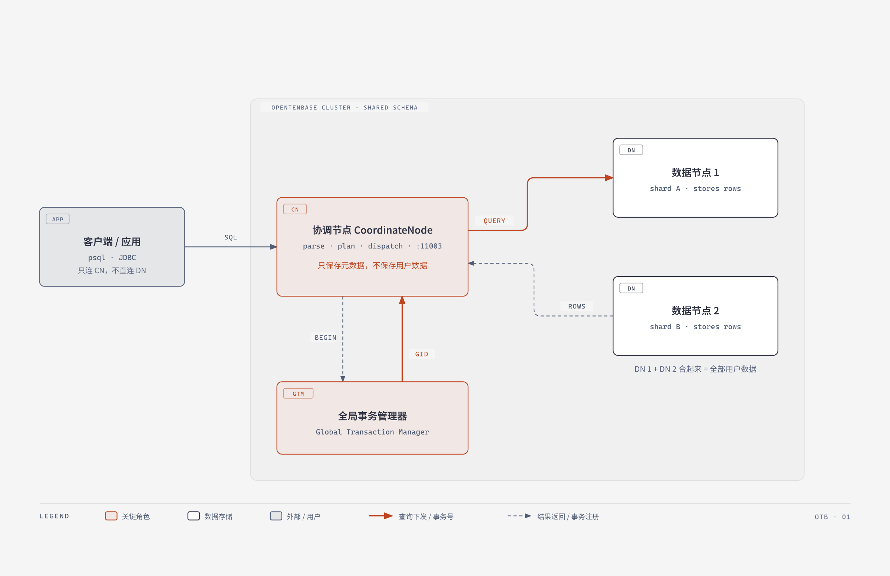

# OpenTenBase 图解卡片：CN / DN / GTM 到底谁在做什么

这是一份面向新手的**数据库概念图解卡片**（活动方向 2）。目标读者是第一次接触
OpenTenBase、看到 `CN`、`DN`、`GTM` 三个缩写就卡住的同学。

卡片用一张图回答三个问题：

1. 我的 SQL 先到哪个节点？
2. 数据到底存在哪里？
3. GTM 又是干什么的，为什么它不存数据却很重要？

## 文件说明

| 文件 | 用途 |
|---|---|
| `diagram/cluster-architecture.html` | 主交付物。单文件图解卡片，双击即可在浏览器打开，含读图说明、生活类比和参考来源 |
| `diagram/cluster-architecture.svg` | 从 HTML 导出的独立 SVG，便于嵌入其他文档或幻灯片 |
| `diagram/cluster-architecture.png` | 位图版本，可直接贴进 Issue / PR / PPT |
| `evidence/diagram-review.md` | 图中每一条技术表述与仓库文件的逐项核对表 |
| `evidence/ai-usage-log.md` | 使用 AI 辅助的过程记录（生成了什么、人工核对了什么） |
| `evidence/peer-feedback.md` | 另一位同学试读后的复述与反馈记录 |

## 一句话结论

> 用户只连 **CN**；**CN** 解析 SQL、把查询拆成片段下发，自己**只存元数据**；
> **DN** 存放**全部用户数据**；**GTM** 不存业务数据，只为跨节点事务分配
> **全局事务号**。CN 与 DN **共享同一份 schema**。

## 图里画了什么



读图顺序：

1. 左侧**客户端**只有一条出边——它连的是 CN，不是 DN。
2. **CN** 是橙色焦点：只做解析、计划、下发，标注"只保存元数据，不保存用户数据"。
3. 右侧两个**数据节点**：用户数据按分片切开分别存放，两者合起来才是全部数据。
4. 下方 **GTM** 也是橙色焦点：与 CN 之间是"注册事务 / 领取全局事务号"的双向箭头。
5. 外层虚线区域标着 `SHARED SCHEMA`：CN 和 DN 共享同一份表结构定义。

## 生活类比（仅帮助建立直觉）

顾客（客户端）只跟服务员（CN）点单；服务员把一桌菜拆成几份交给不同灶台（DN）；
收银台（GTM）给这一桌开一个总单号，保证几道菜算同一笔账。

**类比不是技术定义。** CN 不做数据计算、GTM 不参与查询执行、DN 不对外提供完整
SQL 入口——这些边界以项目文档为准，核对结果见 `evidence/diagram-review.md`。

## 技术表述的来源

图中所有技术表述都可以在仓库里核对到出处，主要三条：

- `README_ZH.md:13`：集群由 CoordinateNodes、DataNodes、GTM 组成；所有用户数据存储在 DataNodes 中，CoordinateNode 仅包含元数据，GTM 用于全局事务管理；CoordinateNodes 和 DataNodes 共享相同的模式。
- `README_ZH.md:15`：用户总是连接到 CoordinateNodes，CN 将查询分解为在 DataNodes 中执行的片段，并收集结果。
- `src/include/nodes/parsenodes.h:127-132`：节点类型常量 `PGXC_NODE_COORDINATOR 'C'`、`PGXC_NODE_DATANODE 'D'`、`PGXC_NODE_GTM 'G'`。

完整逐项核对表见 `evidence/diagram-review.md`。

## 如何验证

```bash
# 1. 打开卡片（任选其一）
#    Windows: 双击 diagram/cluster-architecture.html
#    macOS:   open diagram/cluster-architecture.html
#    Linux:   xdg-open diagram/cluster-architecture.html

# 2. 核对图中表述是否有出处
#    见 evidence/diagram-review.md 的表格，逐行对照 README_ZH.md 与源码

# 3. 真实集群里验证"CN 只存元数据"最直接的方式
#    连到 CN 执行，观察 node_type 一列（'C' / 'D' / 'G'）
psql -h 127.0.0.1 -p 11003 -U opentenbase -d postgres \
  -c "select node_name, node_type, node_port, node_host from pgxc_node order by node_type"
```

> 上面的 `psql` 命令来自 `contrib/otb-health/otb_health.sh` 的第 [2] 项检查。
> 没有实际集群时，本卡片不声称任何执行结果；图中也不包含运行输出。

## 与方向 1 的关系

本卡片负责"概念"，团队的方向 1（SQL 入门手册）负责"第一条 SQL"。
建议阅读顺序：先看这张图建立角色分工，再去看 SQL 示例，就不会 confusion
"这条语句到底在哪台机器上跑"。

## 设计说明

- 图解使用 `diagram-design` 技能的 Architecture 类型：单文件 HTML + 内联 SVG，
  正交折线连接、最多 9 个节点、1–2 个珊瑚色焦点（此处为 CN 与 GTM）。
- 沿用该技能默认配色（paper `#f5f5f5`、ink `#2d3142`、accent `#bf4520`），未做品牌定制。
- 无障碍：`<svg role="img">` 带 `<title>` 与 `<desc>`，读屏软件可读出整张图的结论。
