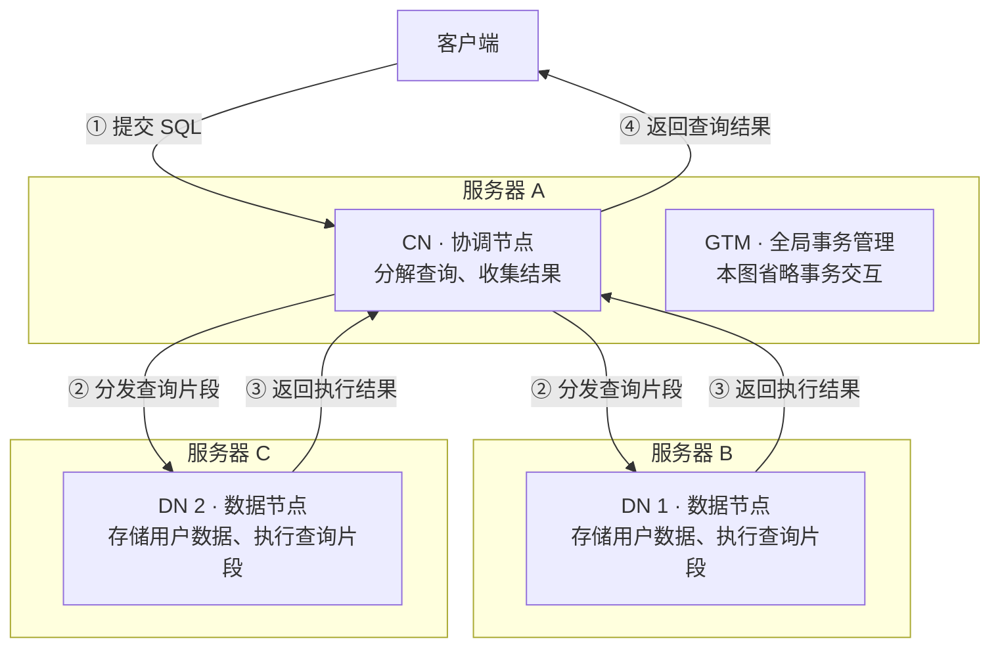

<!-- Copyright (C) 2026 OpenTenBase Authors. Licensed under the BSD 3-Clause License; see ../LICENSE.txt. -->

# CN 与 DN 图解卡片：一条 SQL 如何在分布式集群中完成？

**一句话理解：CN（Coordinator，协调节点）接收用户查询，将查询分解为交给 DN（DataNode，数据节点）执行的片段，再收集结果返回给用户。**

## 背景：为什么数据库要分布式部署？

先想一个场景：订单越来越多，一台服务器能够提供的磁盘空间、计算能力和处理请求的能力都有上限。分布式数据库的一种思路，是让多个数据节点共同存储、处理数据，而应用仍然通过 SQL 访问数据库。

这样就需要解决两个问题：**数据由谁保存和处理？一次查询涉及多个节点时，由谁协调？** 在 OpenTenBase 的分布式架构中，DN 承担用户数据的存储和查询片段的执行，CN 承担查询协调与结果收集。项目还使用 GTM 进行全局事务管理，配合多个节点处理事务。

这里要分清三个词：**集群**是一起工作的数据库节点集合；**节点**是具有特定角色的数据库实例；**服务器**是承载这些实例的机器。节点与服务器并非一一对应：同一台服务器可以部署不同角色的节点，也可以配置多个同类节点。把多个节点放在一台机器上可以体验分工，但可用资源和故障仍会受这台机器影响。

分布式也会增加网络通信、查询协调和事务管理的成本，因此不能把“节点更多”直接理解为“每条 SQL 都更快”。

## CN 与 DN：各自负责什么？

| 对比项 | CN：Coordinator，协调节点 | DN：DataNode，数据节点 |
| --- | --- | --- |
| 核心职责 | 接收查询，分解查询，收集结果 | 存储用户数据，执行查询片段 |
| 从读者视角理解 | 查询的协调入口 | 数据实际存放和处理的地方 |
| 数据与元数据 | 项目概览说明 CN 包含元数据；不要把它当成用户表数据的存储节点 | 项目概览说明用户数据存放在 DN |
| 与另一类节点的配合 | 将查询片段交给相应 DN，收集返回结果 | 执行分配到的片段，并返回执行结果 |

“元数据”可以理解为描述数据库结构的信息，例如表的结构；“用户数据”则是表里的业务记录，例如订单。

## 一张图看懂部署与查询分工



这是一种示意部署：一台服务器承载 CN 与 GTM，另外两台服务器各承载一个 DN。服务器边框表示部署位置，箭头表示这次查询的请求和结果方向。它不是固定部署要求，也不是完整的网络通信图；图中没有展开主备、事务交互和异常分支。

图里的查询涉及两个 DN。实际查询访问哪些 DN，取决于数据分布、查询条件和执行计划，并非每条 SQL 都必须访问所有 DN。GTM 单独列出，是为了说明分布式集群还需要全局事务管理；不能把它理解成 SQL 必须依次经过的“CN → GTM → DN”中转站。

## 跟着一条订单查询走一遍

假设有一张 `orders` 订单表，数据分布在两个 DN 上，我们想找出待发货的订单编号：

```sql
SELECT order_id FROM orders WHERE status = '待发货';
```

为便于说明，假设本次查询需要读取两个 DN，并且数据如下：

| 节点 | 该节点保存的示例记录 | 符合条件的订单编号 |
| --- | --- | --- |
| DN 1 | 订单 101：待发货；订单 102：已发货 | 101 |
| DN 2 | 订单 203：待发货；订单 204：已取消 | 203 |

1. **客户端提交：**应用把这条 SQL 发给 CN，应用不用分别向两个 DN 提交查询再自行拼接结果。
2. **CN 协调：**CN 将查询分解为需要在相应 DN 上执行的片段。
3. **DN 执行：**两个 DN 分别处理自己负责的数据，返回符合条件的订单编号。
4. **CN 收集并返回：**CN 收集执行结果，客户端最终得到订单 101 和 203。SQL 没有指定 `ORDER BY`，这里的列举顺序不表示结果顺序保证。

这是帮助理解职责的示例，不是实际执行计划或运行日志。订单编号与节点的对应关系是假设，不能据此推断真实的分布规则；实际计算在哪个节点进行，以执行计划为准。

## 用生活类比帮助理解

把 CN 想成餐厅服务员：接下订单，交给不同的后厨工作区，再把菜送到顾客面前；DN 类似保存食材并实际制作的后厨工作区。顾客面对一个点单入口，背后可以有多个工作区协作。这个类比只解释职责分工，不能用来推导数据库的存储方式、事务机制或性能。

**常见误解：连接 CN，就表示用户数据存放在 CN。** 根据项目概览，用户数据存放在 DN，CN 包含元数据。客户端连接入口与用户数据的存储位置是两回事。

**常见误解：两个 DN 就是同一份数据的两份备份。** DN 的数量与主备关系是不同的配置维度。安装文档分别列出了数据节点的 `master`、`slave` 和 `nodes-per-server`；仅凭“有两个 DN”无法判断数据是否互为备份。本图没有画备份关系。

## 参考资料与逐项核对

| 图中关键表述 | 项目资料与核对依据 |
| --- | --- |
| 客户端向 CN 提交查询 | [中文 README：使用](../README_ZH.md#使用) 明确要求连接 CN 主节点执行 SQL，并提供 `psql` 示例。 |
| CN 将查询分解为 DN 执行的片段 | [中文 README：概览](../README_ZH.md#概览) 明确描述查询分解与执行分工。 |
| DN 存储用户数据 | [中文 README：概览](../README_ZH.md#概览) 明确说明用户数据存储在 DataNodes。 |
| CN 收集执行结果 | [中文 README：概览](../README_ZH.md#概览) 明确说明协调节点收集结果。 |
| 分布式模式包括 GTM、CN、DN | [中文 README：生成并填写配置文件](../README_ZH.md#生成并填写配置文件) 中的 `instance.type` 说明列出三类节点；GTM 职责见概览。 |
| 节点与服务器不是一一对应 | [中文 README：生成并填写配置文件](../README_ZH.md#生成并填写配置文件) 中的 `nodes-per-server` 说明每台服务器可部署多个节点，后续配置示例还将不同角色放在相同 IP 上。 |
| DN 数量与主备配置是不同维度 | [中文 README：生成并填写配置文件](../README_ZH.md#生成并填写配置文件) 分别说明 `datanodes.master`、`slave` 和 `nodes-per-server`。 |

以上项目职责与部署描述已对照仓库文档核对。扩容动机、生活类比和订单数据是解释性示例，不代表项目性能承诺或实测结果。

## 继续阅读

想继续实践？从 [安装步骤](../README_ZH.md#安装) 搭建集群，再按 [使用示例](../README_ZH.md#使用) 连接 CN。
