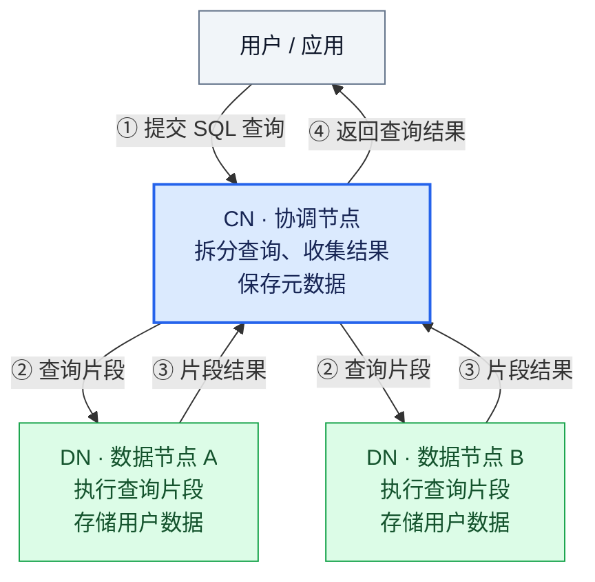

<!--
Copyright (C) 2026 OpenTenBase Authors. All rights reserved.
SPDX-License-Identifier: BSD-3-Clause
See ../../LICENSE.txt for license terms.
-->

# 数据库图解卡片：CN 如何协调一次查询？

> **一句话：** 在 OpenTenBase 分布式集群中，CN（协调节点）接收用户查询，把查询拆成由 DN（数据节点）执行的片段，再收集结果。[1]

## 一张图看懂

**读图范围：** 这是帮助理解 CN 职责的简化示意，假设一次查询涉及图中的两个 DN。两个 DN 是示意数量，不表示每次查询都会访问全部 DN，也不表示集群只能有一个 CN。图中省略了负责全局事务管理的 GTM；它不是完整部署图。[1]

## 简短说明

你想查询数据库里的信息，先把 SQL 交给 CN。CN 负责组织这次查询，让 DN 执行查询片段，并收集结果交回给你。按项目概览的描述，用户数据存放在 DN，CN 保存的是元数据（描述数据的结构等信息）。所以，**连接入口与用户数据存放处是不同的角色**。[1][2]

## 生活类比与常见误解

可以把 CN 想成餐厅服务员：接到一张点菜单，把任务交给厨房，再把菜端回来；DN 像负责制作菜品的厨房。

**类比边界：** “服务员、点菜单、厨房”只是记忆工具，不是数据库的真实组件。图里的两个 DN 不代表固定两间厨房，也不能据此推断实际查询的执行顺序、并行方式或数据分布。

**常见误解：** “我连的是 CN，所以表里的所有业务数据也保存在 CN。”

**纠正：** 项目概览说明用户数据存储在 DN，CN 仅包含元数据；CN 还承担查询拆分和结果收集，并非只做连接转发。[1]

## 关键表述逐项核对

核对日期：2026-11-07。以下链接固定到提交 `123e2b3e8e2d6d0091ea82646d46432cb7a73682`，避免分支更新后依据发生漂移。

| 图中或说明中的表述 | 项目资料依据 | 核对结果 / 限定 |
| --- | --- | --- |
| 用户 / 应用向 CN 提交 SQL | [1] 概览的用户连接说明；[2] 使用示例 | 一致；本卡片讨论分布式集群 |
| CN 将查询拆分成片段交给 DN | [1] 概览的查询处理说明 | 一致；不规定片段数 |
| DN 执行片段、CN 收集结果 | [1] 概览的查询处理说明 | 一致；返回用户的箭头概括查询交互，不表示底层通信协议 |
| CN 保存元数据 | [1] 概览的节点职责说明 | 一致；不要与用户表数据混淆 |
| DN 存储用户数据 | [1] 概览的节点职责说明 | 一致；图未规定分片或副本布局 |
| 图中只有一个 CN、两个 DN | [1] 概览描述多个节点组成集群 | 教学示意，不是数量限制 |
| 图中省略 GTM | [1] 概览说明 GTM 用于全局事务管理 | 已明确省略，不能把本图当完整架构 |
| 餐厅服务员与厨房 | 作者的教学类比 | 非技术事实，不作为实现依据 |

## 项目文档参考

1. [README_ZH.md：概览](https://github.com/hengliquan3-ops/OpenTenBase/blob/123e2b3e8e2d6d0091ea82646d46432cb7a73682/README_ZH.md#概览) —— 节点职责、数据存放位置、查询处理流程。
2. [README_ZH.md：使用](https://github.com/hengliquan3-ops/OpenTenBase/blob/123e2b3e8e2d6d0091ea82646d46432cb7a73682/README_ZH.md#使用) —— 连接 CN 主节点执行 SQL 的示例。

## 课堂展示：请同学用自己的话复述

请一位同学先阅读图和简短说明，再遮住文字，用 30～60 秒回答：

1. 用户把查询交给谁？它接下来做什么？
2. 用户数据主要存放在哪里？查询结果怎样回来？
3. “CN 像服务员”这个类比，哪些部分不能当成技术事实？

**通过标准：** 能说出“用户连接 CN”“CN 拆分查询并收集结果”“DN 存储用户数据并执行片段”；能指出图是简化示意，类比不是实现说明。不要求背诵原句。

**复述记录（现场填写，不预填评价）：**

| 项目 | 记录 |
| --- | --- |
| 同学称呼 / 日期 | 待填写 |
| 同学的原话 | 待填写 |
| 哪个地方不清楚 | 待填写 |
| 根据反馈做的改进 | 待填写 |
| 结果 | 待实际展示后评定 |

当前状态：图解、说明和资料核对已完成；真实同学的阅读与复述尚待课堂进行。
