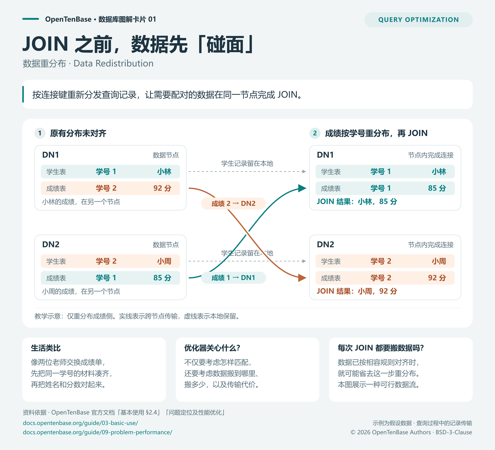

<!-- Copyright (c) 2026 OpenTenBase Authors. SPDX-License-Identifier: BSD-3-Clause -->

# JOIN 之前，数据先「碰面」

**概念：分布式 JOIN 中的数据重分布（Data Redistribution）。**

JOIN 按共同字段匹配两张表中的记录。数据分散在不同 DN（数据节点）时，需要匹配的记录可能位于不同节点。一种执行方法是按连接键重新分发查询记录，让相应记录到同一个节点，再在节点内完成 JOIN。OpenTenBase 官方文档的非分布键 JOIN 示例展示了这种数据流。[1]



[打开可编辑 SVG](images/join-redistribution.svg) · [查看 Mermaid 源码](images/join-redistribution.mmd)

## 用一个例子看懂

学生表记录「学号、姓名」，成绩表记录「学号、分数」。我们希望按学号得到每位学生的姓名和成绩：

```sql
SELECT s.name, g.score
FROM students AS s
JOIN grades AS g ON s.student_id = g.student_id;
```

假设学生表中学号 1 的记录在 DN1，学号 2 的记录在 DN2；两条对应成绩恰好位于相反的节点。图中保留学生侧的数据位置，按与学生侧相容的规则重分布成绩记录：学号 1 的成绩发送到 DN1，学号 2 的成绩发送到 DN2，然后分别在节点内完成匹配，得到「小林，85 分」和「小周，92 分」。

这是一个等值内连接的教学例子。姓名、分数、记录位置和数据流均为假设，SQL 用来表达查询语义；本卡片没有运行该 SQL，也不声称优化器一定选择图中的方案。图中重分布描述的是本次查询的数据流，不是修改原表的永久分片定义。

## 一个生活类比

两位老师各拿着一部分学生名单和成绩单。为了把姓名和分数对上，他们先交换相应的成绩单，再分别完成配对。「交换成绩单」类比跨节点传输记录；真实数据库传输的是查询执行过程中的数据。

## 为什么适合查询优化方向

对分布式 JOIN，需要考虑匹配方法，也需要考虑数据分布和传输开销。OpenTenBase 文档建议，分析类查询选择分片键时要考虑关联字段，尽量减少批量跨 DN 数据交互。[1]

与内核实现对应，`set_joinpath_distribution` 处理 JOIN 路径的数据分布，`redistribute_path` 构造所需的重分布路径，`cost_remote_subplan` 估算远程子计划的代价。[3][4] 可以由此继续研究：**优化器如何根据数据分布、估计行数和行宽，比较不同 JOIN 数据流方案的代价？**

## 一个常见误解

**误解：分布式 JOIN 每次都必须重分布数据。**

当两侧数据已按相容的规则分布，连接条件也满足相应要求时，可能直接在 DN 内完成连接，省去额外的 JOIN 重分布。OpenTenBase 文档提供了需要与不需要重分布的不同示例。[1][2] 省去这一步不代表查询完全没有网络通信，例如返回结果仍可能需要传输。

## 图中关键表述的核对

| 卡片表述 | 项目资料依据 | 适用范围 |
| --- | --- | --- |
| 分片键影响记录的数据分布 | [1] §1.1：`distribute by shard(x)` 指定分布键 | 图中具体学号与 DN 的对应关系是假设，不是项目默认映射 |
| JOIN 可以先重分布记录，再在 DN 内执行 | [1] §2.4「非分布键 JOIN 查询」；[2]「查看 join 发生的节点」 | 图中展示仅重分布成绩侧的一种可行方案 |
| 并非每次 JOIN 都需要重分布 | [1] §2.4 的分布键与非分布键 JOIN 示例；[2]「查看是否为分布 key join」 | 需要结合实际分布、连接条件和执行计划判断 |
| 重分布与代价估算有关 | [3] `redistribute_path`、`set_joinpath_distribution`；[4] `cost_remote_subplan` | 源码链接固定到本次核对的提交，未进行性能测量 |
| 两位老师交换成绩单 | 本文设计的生活类比 | 用于理解概念，不是数据库的技术实现描述 |

## 请同学用自己的话复述

看图后，请同学回答两个问题：

1. 为什么图里需要交换成绩记录？
2. 如果姓名和对应成绩原本就在同一个 DN，这一步能否省去？

判断要点：能说明「需要匹配的记录最初分散在不同节点」；能说明在满足分布与连接条件时，可以省去图中的成绩侧重分布。课堂反馈应在实际展示后记录，本卡片尚未进行同学复述验证。

## 参考资料

1. [OpenTenBase 官方文档：基本使用](https://docs.opentenbase.org/guide/03-basic-use/)，§1.1「创建 shard 普通表」、§2.4「SELECT」。
2. [OpenTenBase 官方文档：问题定位及性能优化](https://docs.opentenbase.org/guide/09-problem-performance/)，「查看是否为分布 key join」「查看 join 发生的节点」。
3. [OpenTenBase 源码：pathnode.c](https://github.com/OpenTenBase/OpenTenBase/blob/123e2b3e8e2d6d0091ea82646d46432cb7a73682/src/backend/optimizer/util/pathnode.c)，`redistribute_path`、`set_joinpath_distribution`。
4. [OpenTenBase 源码：costsize.c](https://github.com/OpenTenBase/OpenTenBase/blob/123e2b3e8e2d6d0091ea82646d46432cb7a73682/src/backend/optimizer/path/costsize.c)，`cost_remote_subplan`。

资料核对日期：2026-11-07。本文和原始 SVG、Mermaid 源码使用项目的 [BSD-3-Clause 许可](../../LICENSE.txt)；PNG 由同目录 SVG 导出。
