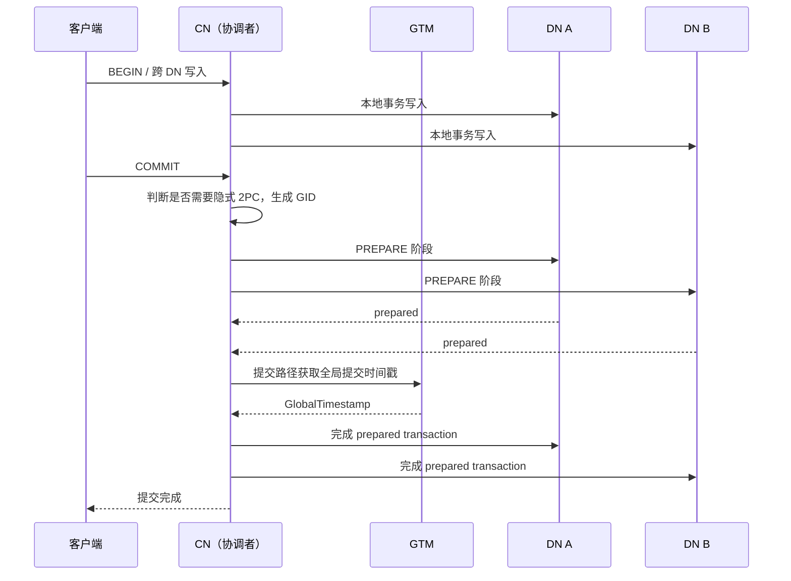

<!-- Copyright (C) 2026 OpenTenBase Authors. Licensed under BSD-3-Clause; see ../LICENSE.txt. -->

# 分布式事务原理：从 CN 提交到 DN 可见性

本文回应 [issue #318](https://github.com/OpenTenBase/OpenTenBase/issues/318)，面向希望从使用进入源码阅读的读者。源码核对基线为 `123e2b3e8e`；讨论 v5.0 系列源码中启用 `__SUPPORT_DISTRIBUTED_TRANSACTION__` 的路径。编译条件、配置和事务参与节点会改变具体行为，不能把旧版 Postgres-XC 的机制直接套用到所有构建。

## 阅读导航

1. [部署与连接](../README_ZH.md)：先准备可用的 CN、DN 和 GTM。
2. [角色与标识](#角色与标识)：区分 XID、GID、GTS 和 CSN。
3. [跨节点提交](#跨节点提交)：理解何时进入两阶段提交。
4. [快照与可见性](#快照与可见性)：理解时间戳如何参与读一致性。
5. [实验与验证边界](#实验与验证边界)：在双 DN 集群检查提交、回滚和隔离行为。
6. [故障与运维](#故障与运维)：了解 prepared 状态和恢复边界。
7. [源码阅读入口](#源码阅读入口)：按函数继续追踪实现。

## 角色与标识

客户端通常连接 CN。CN 规划并分发查询、跟踪事务参与节点；DN 保存业务数据并执行本地读写；GTM 为这里讨论的分布式路径提供全局时间戳等服务。CN 可以因本地写入而成为提交参与者，不能把“CN 不存业务分片”理解为“CN 永远没有本地事务”。

| 名称 | 用途 | 不应混淆为 |
| --- | --- | --- |
| XID | 标识本地事务，关联元组版本和事务状态 | 集群内每次都由 GTM 分配的全局递增编号 |
| GID | 标识 prepared transaction，关联两阶段提交参与者 | 普通行的主键或提交时间戳 |
| GTS / GlobalTimestamp | 全局时间戳接口返回的值，用于快照、prepare 或 commit 等不同阶段 | SQL 的 `now()` 返回值 |
| CSN / 提交时间戳 | 在所述实现中用于记录提交顺序及可见性判断；带有状态编码 | 一种可以代替整个提交协议的机制 |

`GetNewTransactionId()` 调用 `GetNewTransactionIdInternal()`，后者从本地 `ShmemVariableCache->nextXid` 分配 XID，并有竞争时的分组获取路径。因此，源码仍保留 `BeginTranGTM()` 等接口，并不证明所有事务都通过它分配 XID。`txid_current()` 的输出也不能单独证明集群全局唯一性或 GTM 请求次数。

## 跨节点提交

对于从客户端进入 CN 的常规、非临时对象写事务，CN 的 `CommitTransaction()` 通过 `IsTwoPhaseCommitRequired()` 判断是否需要隐式 2PC。它检查已登记连接的写入和事务状态，在发现第二个写参与者时返回真，本地写入也参与计数。

这里有明确的例外：DN 到 DN 的连接不在这个函数中发起 2PC；`enable_2pc_optimization` 打开时该函数返回假；访问临时对象时也跳过该 2PC 路径，代码明确提示故障情况下可能出现不一致。无有效顶层 XID 时同样不进入此路径。因此，“访问两个 DN”不等于“两个 DN 都参与写入”，更不能说所有 SQL 都走 2PC。

以下是需要隐式 2PC 时的逻辑流程，省略了错误分支、日志及本地参与者的细节：



这是函数级概览，并非网络报文逐条记录。`pgxc_node_remote_finish()` 的提交路径获取全局提交时间戳，具体调用取决于编译分支。CN 本地没有写入时，`PrePrepare_Remote()` 可以直接继续完成远端 prepared transaction；本地有写入时还需要本地 prepare 和后续 finish。不要把两个函数名称理解成两个阶段固定各执行一次。

对应调用关系：

```text
CommitTransaction
  ├─ IsTwoPhaseCommitRequired
  ├─ 需要 2PC：生成隐式 GID
  │    ├─ 本地也写入：PrepareTransaction
  │    └─ 仅远端写入：PrePrepare_Remote
  │                       ├─ pgxc_node_remote_prepare
  │                       └─ 隐式且无本地参与时：pgxc_node_remote_finish
  └─ PreCommit_Remote
       ├─ 有待完成本地 prepare 的节点清单：pgxc_node_remote_finish
       └─ 不需要 2PC：pgxc_node_remote_commit
```

用户执行的 `PREPARE TRANSACTION` 属于显式 2PC，和普通 `COMMIT` 内部触发的隐式 2PC 不同。`PrePrepare_Remote()` 在显式、发起 CN 的分支调用 `StartPreparedTranGTM()` 登记信息，不能据此推断每个隐式事务都经过同一登记分支。

## 快照与可见性

### 快照从哪里来

`GetTransactionSnapshot_shard()` 管理事务快照的获取与复用。Read Committed 在后续语句获取新快照；Repeatable Read 使用事务快照。Repeatable Read 的观察起点是首次获取事务快照的操作，而不是简单执行 `BEGIN` 的时刻。

在 `GlobalSnapshotSource == GLOBAL_SNAPSHOT_SOURCE_GTM` 的分布式路径中，`GetSnapshotData_shard()` 调用 `GetPGXCSnapshotData()`。后者可以从 GTM 获取 `start_ts`，也可以在来自 CN/DN 的连接上复用协调者传入的全局快照；恢复、初始化和 `latest` 等分支还有本地最新提交时间戳路径。因此，不是每个 DN、每条语句都独立向 GTM 取一份活动 XID 列表。

尤其要注意，`procarray.c` 中旧的 `GetSnapshotDataFromGTM()` 活动事务列表实现位于 `#if 0` 内。仅看到函数名或旧注释就断言当前构建仍以该方式运行，会误导读者。`GetGlobalTimestampGTMInternal()` 还受 `gts_cache_timeout` 控制：非提交请求可以复用缓存，提交请求走获取新时间戳的路径，所以函数调用次数也不等于网络请求次数。

### 提交时间戳如何参与可见性

`tqual.c` 中的 `HintedXminVisibleByCSN()` 展示了一个已提交插入版本的判断路径：获取元组上的提交时间戳，必要时通过 `CSNLogGetCSNAdjusted()` 查询；对非本地快照比较 `snapshot->start_ts >= global_committs`。完整 MVCC 还需处理删除/更新版本、本事务、未提交事务、prepare 状态等，不能将这一个比较当成所有元组的完整可见性算法。

这说明 v5.0 的相关实现应从“全局时间戳快照 + 提交状态/时间戳”理解。CSN 日志帮助记录和查询状态，但没有消除 CN 对多参与者提交的协调。源码仍然存在 ProcArray、锁及本地快照处理，不能把性能优化描述成“完全删除 ProcArray”，也不能仅凭这些代码确认“性能提升 50%”等需要基准实验的数字。

## 实验与验证边界

配套脚本 [verify_distributed_transactions.py](examples/verify_distributed_transactions.py) 使用 Python 标准库，通过 SSH 调用 VM 的 `psql`。它创建随机命名的专用 schema 和普通分片表；结束时删除该 schema。需要 CN 的建表权限、至少两个 DN、可用的无交互 SSH 和数据库认证。

```bash
python doc/examples/verify_distributed_transactions.py \
  --ssh opentenbase@YOUR_VM \
  --psql /path/to/install/bin/psql \
  --libdir /path/to/install/lib \
  --host YOUR_CN --port 11006 --user opentenbase --dbname postgres
```

脚本检查：

- 插入 1000 行后，至少两个 DN 上实际有数据；逐 DN 计数总和为 1000。
- 跨 DN 更新提交后，行数仍为 1000，值总和由 500500 变为 501500。
- 后续更新回滚后，总和保持 501500。
- 第二个连接提交更新后，Repeatable Read 会话保持原总和，Read Committed 会话读到新总和。

脚本在写会话中设置 `enable_2pc_optimization=off`，避免把优化路径当成普通隐式 2PC 路径；不修改集群持久配置。两阶段提交的内部调用由源码证明，SQL 结果证明观察到的行为，二者证据不同。脚本不暂停 prepare 阶段，因此提交结束后 `pg_prepared_xacts` 为空不能证明“从未发生 2PC”。

测试环境、实际输出和限制见 [验证记录](distributed-transactions-validation.md)。这些实验不涵盖主备切换、GTM 故障、网络分区、崩溃恢复、多 CN 或性能压测，不证明所有故障窗口中的原子性。

## 故障与运维

prepared 是中间状态，不是失败事务的同义词。提交决议传播期间的故障可能需要恢复流程继续完成，不能将“连接断开”理解为“所有节点必然已经回滚”。`max_prepared_transactions` 是容量配置，不能代替全局决议恢复。

遇到残留时，先保留 CN/DN/GTM 日志并核对 GID、参与节点及全局决议，再依据对应版本运维文档处理。不要删除 `pg_twophase` 文件，或仅凭一个 DN 的状态任意执行 `COMMIT PREPARED` / `ROLLBACK PREPARED`。项目的清理扩展入口为 [pg_clean](../contrib/pg_clean/)，prepared 状态实现可从 [twophase.c](../src/backend/access/transam/twophase.c) 继续阅读。

## 源码阅读入口

相对链接指向仓库文件；函数名用于检索，避免代码移动后固定行号失效。

| 要确认的问题 | 文件与函数 |
| --- | --- |
| CN 如何启动提交 | [xact.c](../src/backend/access/transam/xact.c)：`CommitTransaction`、`PrepareTransaction` |
| 什么时候需要 2PC、如何 prepare/finish | [execRemote.c](../src/backend/pgxc/pool/execRemote.c)：`IsTwoPhaseCommitRequired`、`PrePrepare_Remote`、`PreCommit_Remote`、`pgxc_node_remote_finish` |
| 本地 XID 如何分配 | [varsup.c](../src/backend/access/transam/varsup.c)：`GetNewTransactionId`、`GetNewTransactionIdInternal` |
| 全局时间戳客户端接口 | [gtm.c](../src/backend/access/transam/gtm.c)：`GetGlobalTimestampGTM`、`GetGlobalTimestampGTMForCommit` |
| 快照获取与复用 | [snapmgr.c](../src/backend/utils/time/snapmgr.c)：`GetTransactionSnapshot_shard` |
| 快照时间戳的来源 | [procarray.c](../src/backend/storage/ipc/procarray.c)：`GetSnapshotData_shard`、`GetPGXCSnapshotData`、`GetGlobalTimestampFromGTM` |
| 元组可见性 | [tqual.c](../src/backend/utils/time/tqual.c)：`HintedXminVisibleByCSN`、`HintedXmaxVisibleByCSN` |
| 提交状态日志 | [csnlog.c](../src/backend/access/transam/csnlog.c)：`CSNLogSetCSN`、`CSNLogGetCSNAdjusted` |

继续阅读：[贡献指南](../CONTRIBUTING_ZH.md)、[SQL 事务使用说明的源文档](src/sgml/advanced.sgml)。修改本文涉及的机制时，应同时核对编译条件和调用方，而非只摘取函数内部注释。
