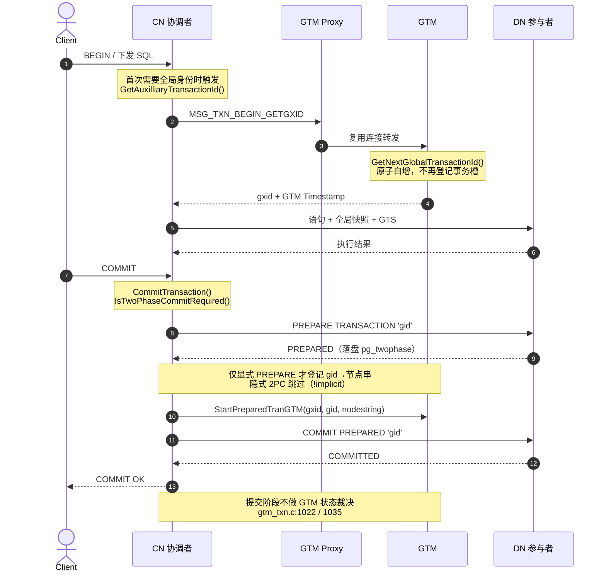

# 图解 OpenTenBase：GTM 全局事务管理器

> 一句话：**GTM 不是“提交裁判”，而是“取号机 + 统一挂钟 + 2PC 登记簿”。**

## 1. 核心机制图解

**图注**：GTM 只在事务开始时被访问一次（取 gxid + 时间戳），并在显式两阶段提交时登记 `gid → 参与者节点串`；真正的“一起提交”由 CN 驱动 DN 完成 `PREPARE TRANSACTION` → `COMMIT PREPARED`，提交阶段不再回访 GTM 做裁决。

## 2. 生活类比（银行网点的“跨窗口转账”）

想象你去银行办一笔要同时改动好几个窗口账目的业务：

- 进门先到**取号机**取一个全行唯一的**号码**，机器顺手把当前时间打印在号单上。取号机只发号、报时，**不关心你办什么业务，也不决定你能不能办成**。
- **大堂经理**拿着号单，带你到 3 号、7 号两个窗口分别办理；办理期间，经理会告诉每个柜员“现在是几点、哪些号还在办”，保证两个窗口看到的先后顺序一致。
- 要动两个窗口的账，经理不会让柜员先落章，而是让每个柜员**把材料装袋、封口、签“待定”**——钱没动，但已锁定，随时能落章。
- 两个窗口都封好袋，经理才统一喊一声“**落章**”，钱同时生效；只要有一个窗口封不了袋，就让所有窗口撕袋作废。
- 冷知识：**落章后不用再回取号机汇报**。取号机只在“跨窗口待定业务”上做个登记（哪笔业务涉及哪几个窗口），方便日后查账与清理残留。

## 3. 🛡️ 事实核查

> 类比只是脚手架，下表逐条对齐真实机制，所有源码行号均可点击跳转。

| 类比中的动作 | 真实技术机制 | 源码依据（DSH + CodeGraph 核实） |
|---|---|---|
| 取号机吐出一个全行唯一的号 | GTM 原子分配全局事务号 GXID，一次往返同时返回时间戳 | [gtm.c:1973](src/backend/access/transam/gtm.c#L1973) `BeginTranGTM()` → [gtm_client.c:761](src/gtm/client/gtm_client.c#L761) `begin_transaction()` → [gtm_txn.c:1864](src/gtm/main/gtm_txn.c#L1864) `ProcessBeginTransactionGetGXIDCommand()` → [gtm_txn.c:1395](src/gtm/main/gtm_txn.c#L1395) `GetNextGlobalTransactionId()` |
| 大厅挂钟统一报时 | GTM 作为全局时间戳（GTS）源；提交时取 GTS 定序 | [gtm_txn.c:1635](src/gtm/main/gtm_txn.c#L1635) `ProcessGetGTSCommand()` → [gtm_txn.c:1412](src/gtm/main/gtm_txn.c#L1412) `GetNextGlobalTimestamp()`；[gtm.c:1961](src/backend/access/transam/gtm.c#L1961) `GetGlobalTimestampGTM()` |
| 经理告诉柜员“现在几点、哪些号在办” | CN 把全局快照 + GTS 随语句下发给 DN | [pgxcnode.c:4396](src/backend/pgxc/pool/pgxcnode.c#L4396) `pgxc_node_send_snapshot()` → DN 侧 [procarray.c:4449](src/backend/storage/ipc/procarray.c#L4449) `SetGlobalSnapshotData()` |
| 柜员先装袋、封口、签“待定” | DN 执行 `PREPARE TRANSACTION`，两阶段状态落盘 | [xact.c:3684](src/backend/access/transam/xact.c#L3684) `PrepareTransaction()` → [twophase.c:1335](src/backend/access/transam/twophase.c#L1335) `StartPrepare()` / [twophase.c:1448](src/backend/access/transam/twophase.c#L1448) `EndPrepare()` |
| 经理挨个窗口确认“都封好了” | CN 两阶段提交第一阶段，向所有写过的 DN 发 PREPARE | [execRemote.c:7924](src/backend/pgxc/pool/execRemote.c#L7924) `PrePrepare_Remote()` → [execRemote.c:3943](src/backend/pgxc/pool/execRemote.c#L3943) `pgxc_node_remote_prepare()` |
| 经理在登记簿上记“这笔涉及哪几个窗口” | GTM 登记 `gid → 参与者节点串`（仅显式 PREPARE） | [execRemote.c:7970](src/backend/pgxc/pool/execRemote.c#L7970) 调用 `StartPreparedTranGTM()` → [gtm.c:2271](src/backend/access/transam/gtm.c#L2271)；服务端 [gtm_txn.c:3179](src/gtm/main/gtm_txn.c#L3179) `ProcessStartPreparedTransactionCommand()` |
| 全部封好，统一喊“落章” | CN 发 `COMMIT PREPARED`，第二阶段提交 | [execRemote.c:8463](src/backend/pgxc/pool/execRemote.c#L8463) `pgxc_node_remote_finish()`；显式提交走 [execRemote.c:8325](src/backend/pgxc/pool/execRemote.c#L8325) `FinishRemotePreparedTransaction()` |
| 有一个窗口封不了，全部撕袋作废 | 任一 prepare 失败即整体回滚 | [execRemote.c:5700](src/backend/pgxc/pool/execRemote.c#L5700) `pgxc_node_remote_abort()` |
| 落章后不用再回取号机汇报 | **提交阶段不访问 GTM 做状态裁决** | [gtm_txn.c:1022](src/gtm/main/gtm_txn.c#L1022) 注释 `commit transaction will not bother GTM`；[gtm_txn.c:1035](src/gtm/main/gtm_txn.c#L1035) 函数首句 `return txn_count;` |
| 所有窗口先经过一道分流栏杆 | GTM Proxy 复用连接，多后端共享少量到 GTM 的链路 | [proxy_main.c](src/gtm/proxy/proxy_main.c)（默认 6666 → GTM 50001，见 [gtm_proxy.conf.sample](src/gtm/proxy/gtm_proxy.conf.sample)） |

**⚠️ 类比的边界**

1. 取号机不是行长——**GTM 不裁决提交**，跨节点提交顺序由 **GTS** 决定。
2. **GTM 直取快照的老路径已失效**：`GetSnapshotDataFromGTM` 整段被 `#if 0` 关闭（[procarray.c:4613](src/backend/storage/ipc/procarray.c#L4613)），快照改由 CN 下发——照搬 Postgres-XC 旧资料最容易讲错这一点。

**复核方式**：`git grep -n "GetNextGlobalTransactionId" src/gtm/main/gtm_txn.c` 等命令可直接定位上述符号；行号基于当前工作区源码。

## 4. 试读反馈

- 试读人：[待填]
- 反馈记录：[待填]

## 附：2 分钟路演口播稿（约 390 字）

> 用途：现场口头展示，约 2 分钟。面向偏应用与架构方向的听众，刻意不深入 C 代码细节。

评委老师好。先说一个我们踩过的坑：想搞懂一个开源数据库，翻源码，一天啃不完一个模块；丢给大模型，它张口就来——函数名、行号、调用链，编得比真的还像。

我们的解法是：不让 AI 猜，让 AI 查。用 DSH 加 CodeGraph，先给 OpenTenBase 建一张代码知识图谱：2789 个文件、8.4 万个节点、30.8 万条调用边。每次提问，AI 顺着图谱找真实调用链，拿回来的是带行号的源码，不是想象。

举个最通俗的例子。GTM 就像银行网点的取号机：进门取一个全行唯一的号，顺手报个时。大堂经理拿着号，带你去 3 号、7 号窗口；先让每个窗口封袋签“待定”，都封好了，才统一喊落章。GTM 就干三件事：发号、报时、登记这单涉及哪几个窗口。

图谱还帮我们逮到一个反直觉的细节：gtm_txn.c 第 1022 行，白纸黑字写着——提交事务根本不去找 GTM。很多老资料都讲错了，我们没有。

所以 CodeGraph 就是 Agent 的外部记忆：知识不在模型参数里，在图谱里，可查、可验、可追溯。这就是我们对 DATA × Memory 的答案。谢谢大家。
