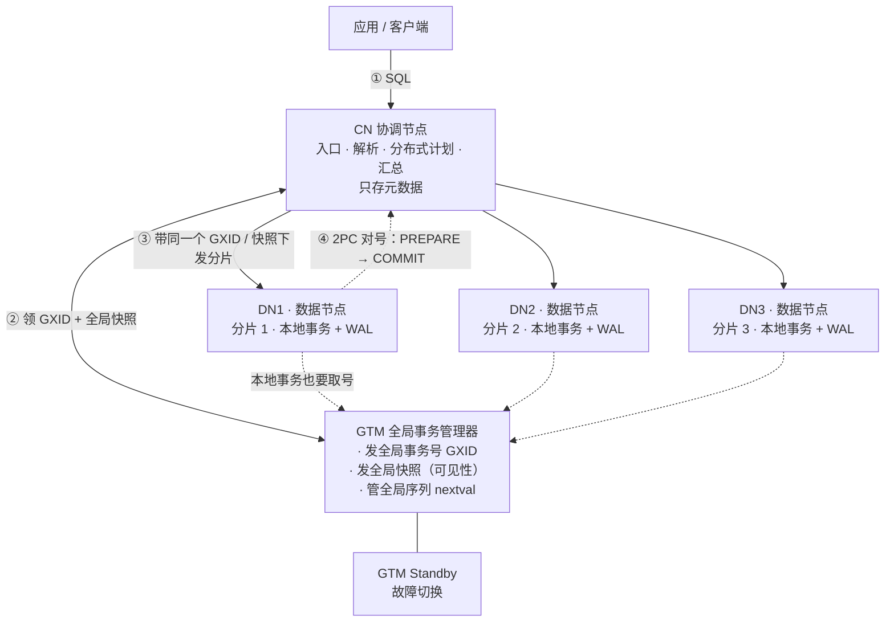

# GTM：给整个集群发号的那个节点

> 一句话：GTM 是集群里唯一有权发号的地方。每个事务开始前，都要向它领一个全集群唯一的号（GXID）和一份「此刻谁可见」的快照。它不存业务数据，也不执行 SQL。

OpenTenBase 有三个角色：CN 接活、DN 干活、GTM 发号。前两个好理解，「发号」的 GTM 最容易被忽略，也最容易被讲错。

## 1. 一张图：一条 SQL 的旅程



图里的关键点是：**GTM 不在数据通路上**，它只在「开事务」这一刻被所有节点询问。

### 这条路上发生了什么

1. **连 CN。** 客户端只连协调节点。CN 上只有元数据，业务数据一行都不在这里。
2. **要号 + 取快照。** CN 开事务时向 GTM 领一个 GXID，并取一份全局快照，它决定了「此刻哪些事务算已提交」。
3. **下发分片。** CN 把 SQL 拆成能在各 DN 执行的片段，连同同一个 GXID 和同一份快照一起发下去。三个 DN 看到的是同一个「版本的世界」。
4. **各 DN 执行。** 数据在本地，事务也在本地跑；MVCC 判断某行版本可不可见时，用的是 GTM 给的那份快照，而不是自己的表。
5. **对号入座地提交。** 跨 DN 的写要两阶段提交（PREPARE → COMMIT）。协调者是 CN，GTM 给的那个 GXID 就是各 DN 用来确认「我们提交的是同一个事务」的凭证。
6. **汇总。** CN 把各 DN 的结果拼回去，返回给客户端。

## 2. GTM 到底管四件事

| 职责 | 说明 |
|---|---|
| **发号：GXID** | 全集群唯一、单调递增的事务号。源码里上限是 `0xFFFFFFFF`，并且专门写了回卷处理。 |
| **发快照：可见性** | 让分散在不同机器上的同一个事务，对「谁已提交」有同一份答案——这是分布式 MVCC 能成立的前提。 |
| **管全局对象：序列** | 跨 DN 的 `nextval()` 必须由它统一发，否则两个 DN 会发出同一个值，主键直接撞车。 |
| **顺带：全局时间戳** | 源码里还有 `GetGlobalTimestampGTM()`，用于给出全局时间戳（GTS）。 |

## 3. 生活类比：连锁奶茶店的中央取号机

一条街上开了三家分店（三个 DN），每家店都会自己做奶茶（执行查询），但号码不能自己编——全公司只有一台中央取号机（GTM）。顾客拿到 37 号，无论去哪家店，37 号只有一个人。取号机上还挂着一面标准钟，所有店按它判断「谁先到、谁后到」。

店长（CN）负责接单、把一张大单拆给几家店做，最后把杯子收齐递给顾客。店长不自己摇奶茶。

**类比的边界（必须说清）：**

1. 取号机不发原料、不碰数据——这点成立，GTM 里没有业务数据。
2. 「取号机坏了就开不了新单」也是真的：新事务领不到号就走不下去，所以要用 Standby 来避免 GTM 单点。
3. 类比覆盖不到的部分：全局序列、全局时间戳、GTM Proxy 的连接汇聚，奶茶店里没有对应物，**别硬套**。

## 4. 四个常见误解

| 误解 | 事实 | 出处 |
|---|---|---|
| 「GTM 是主库，数据最终落到 GTM。」 | 所有用户数据都在 DN，CN 只存元数据，GTM 里没有任何业务数据。它管的是「事务的顺序与可见性」，不是「行」。 | [`README.md`](../../../README.md) 架构段 |
| 「GTM 负责两阶段提交，是分布式事务的协调者。」 | 协调者是 CN。GTM 只提供 GXID 和快照，让同一个事务在各 DN 上「对得上号」。 | [`gtm.c`](../../backend/access/transam/gtm.c) 中 `CommitPreparedTranGTM` 的参数与注释 |
| 「GXID 是 64 位整数，能撑 18 亿以上不重复。」 | 不少网文这么写。源码里是 32 位，而且代码显式处理了回卷。 | [`gtm_gxid.h`](../../include/gtm/gtm_gxid.h) |
| 「数据都要过 GTM，所以它是性能瓶颈。」 | 数据不流经 GTM。只有开事务、取快照、取序列这类控制请求会访问它，部署上还有 GTM Proxy 分担连接。 | [`gtm.c`](../../backend/access/transam/gtm.c) + [`src/gtm/proxy`](../proxy) |

### 关于 GXID 是 32 位这件事

```c
typedef uint32	GlobalTransactionId;		/* 32-bit global transaction ids */
#define MaxGlobalTransactionId	((GlobalTransactionId) 0xFFFFFFFF)
```

```c
/* advance a transaction ID variable, handling wraparound correctly */
#define GlobalTransactionIdAdvance(dest)	\
	do { \
		(dest)++; \
		if ((dest) < FirstNormalGlobalTransactionId) \
			(dest) = FirstNormalGlobalTransactionId; \
	} while(0)
```

这条值得单独提出来：把它当 64 位的二手文章不少，但源码是 32 位并且带回卷处理。**二手结论，回源码核一遍。**

## 5. 逐项核对：上面每句话的出处

| 表述 | 依据 | 出处 |
|---|---|---|
| 数据全在 DN，CN 只有元数据 | "All user data resides in the DataNodes, the CoordinateNode contains only metadata" | [`README.md`](../../../README.md) · Overview |
| CN 拆查询、DN 执行、CN 收结果 | "divide up the query into fragments ... and collect the results" | [`README.md`](../../../README.md) · Overview |
| GTM 管事务信息与全局对象（序列） | 「负责管理集群事务信息，同时管理集群的全局对象，比如序列等」 | [docs.opentenbase.org 快速入门](https://docs.opentenbase.org/guide/01-quickstart/) |
| 事务开始 → 取快照 → 提交/回滚 | `BeginTranGTM` → `GetSnapshotGTM` → `PrepareTranGTM` / `CommitTranGTM` | [`gtm.c`](../../backend/access/transam/gtm.c) |
| GXID 是 32 位、有回卷 | `MaxGlobalTransactionId` = `0xFFFFFFFF`，配套 `GlobalTransactionIdAdvance` | [`gtm_gxid.h`](../../include/gtm/gtm_gxid.h) |
| 2PC 的 PREPARE / COMMIT 用同一个 gxid 关联 | `CommitPreparedTranGTM(GlobalTransactionId gxid, ...)` | [`gtm.c`](../../backend/access/transam/gtm.c) |
| 主备 + Proxy，目的是消除单点 | "To prevent GTM from SPOF ... GTM-Proxy can reconnect to the new GTM without sacrificing running transactions" | [`src/gtm/README`](../README) |
| 模块确实分事务 / 快照 / 序列 / WAL / 备机 | `gtm_txn.c`、`gtm_snap.c`、`gtm_seq.c`、`gtm_xlog.c`、`gtm_standby.c` | [`src/gtm/main/`](../main) |

## 6. 复述检验：能不能用自己的话讲一遍

1. **GTM 里存的是数据还是号？那它挂了，为什么集群就开不了新事务？**
   提示：存的是号和快照。新事务必须领号才能开始，唯一发号源没了这一步就卡住——这也正是要部署 Standby 的原因。
2. **一条跨两个 DN 的 UPDATE，谁在协调？GTM 在其中到底做了什么？**
   提示：CN 协调两阶段提交；GTM 只发 GXID 和快照，让两个 DN 确认提交的是同一个事务。
3. **为什么 CN 可以随便加机器，GTM 却必须做主备？**
   提示：CN 是对等的、无状态的接入层；GTM 是全局唯一发号源，天然单点。

**60 秒口述模板：**

> GTM 是 OpenTenBase 里的全局事务管理器。它只做三件事：发全局事务号、发全局快照、管全局序列；它不做两件事：不存业务数据、不跑 SQL。一条 SQL 进来先到 CN，CN 去 GTM 领号取快照，再把分片带着同一个快照下发到 DN，DN 本地执行，最后由 CN 汇总。所以 GTM 必须做主备——它一停，全集群都领不到新号。

## 7. 参考

- [OpenTenBase 仓库](https://github.com/OpenTenBase/OpenTenBase) · 架构概述见 README 的 Overview 一节
- [`src/gtm/README`](../README) · GTM 源码目录说明，GTM-Standby 与 GTM-Proxy 的原始描述
- [docs.opentenbase.org · 快速入门](https://docs.opentenbase.org/guide/01-quickstart/) · CN / DN / GTM 三大模块的中文定义
- [docs.opentenbase.org · 组件安装及管理](https://docs.opentenbase.org/guide/05-component/) · GTM 主备的初始化、配置与 `gtm_ctl` 运维命令
